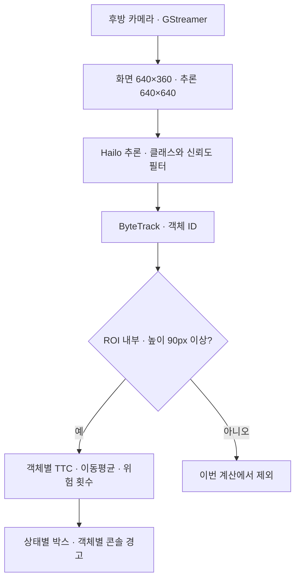

# AI 기반 보행자 후방 안전 보조 스마트 백팩

**후방 영상의 객체 크기 변화로 접근 위험을 판단하는 엣지 비전 프로젝트입니다.** 통제 영상과 실제 보행 환경의 성능 차이를 분석하고, TTC 계산 기준과 시간적 판단 로직을 개선했습니다.

| 핵심 | 내용 |
| --- | --- |
| 목적 | 보행자가 직접 보기 어려운 후방 접근 위험을 영상으로 판단하고 알림 보조 |
| 본인 기여 | **접근 위험 판단 알고리즘 개선·반복 실환경 검증**, 논문 제1저자 |
| 핵심 구현 | 객체 탐지·추적, Bounding Box 기반 TTC, 이동평균, 위험 지속 조건 |
| 검증 결과 | 과거 자체 시험: 통제 영상 약 95% → 보행 환경 50% 이하 → 개선 후 야외 약 85% |
| 기술 | Raspberry Pi 5 · YOLOv8n/HEF · Hailo · Python · OpenCV · ByteTrack |

**위 수치는 기존 개선 버전의 과거 자체 시험 결과이며 현재 main이나 후속 업데이트의 정확도가 아닙니다.** 시험 조건·근거·미확인 항목은 [검증 문서](docs/validation.md)에 구분했습니다.

## 실환경 문제 해결

| 과정 | 내용 |
| --- | --- |
| 문제 | 통제 차량 영상에서 얻은 위험 판별 성능이 실제 보행 환경에서 저하 |
| 원인 분석 | 카메라 흔들림과 객체 자세 변화가 박스 크기와 TTC 판단에 주는 영향 검토 |
| 개선 | 대표 크기 산출 기준과 시간적 판단 로직을 개선하고 반복 야외 시험 수행 |
| 결과 | 기존 개선 버전의 자체 야외 시험에서 약 85%까지 회복 |

현재 코드에서는 `sqrt(width × height)` 기반 TTC, 유효값 이동평균과 위험 조건 3회 누적을 확인할 수 있습니다. 시험 당시 코드와 현재 구현의 정확한 대응, 필터별 기여도는 [알고리즘 문서](docs/algorithm.md)에서 구분합니다.

## 현재 저장소의 처리 흐름

현재 main은 객체별 화면 표시·콘솔 경고까지 포함합니다. **주요 대상 선정·단일 경보·영상/CSV 기록·BLE용 공유 파일은 별도 후속 자료에 있으며 현재 main에는 없습니다.** [버전별 구현 범위](docs/versions.md)

## 기여와 학술 성과

접근 판단 개선과 실환경 검증은 본인의 기여이며, 객체 탐지·장치·통신·앱을 포함한 전체 스마트 백팩 개발은 팀 결과입니다.

2026년 한국정보기술학회 하계종합학술대회 대학생 논문경진대회 **우수논문상(동상)** · 논문 **제1저자**. 참여자 제공 이력이며 공개 가능한 논문·수상 증빙은 보완 예정입니다. 수상과 위 정확도 수치의 검증은 구분합니다.

## 기술 문서

| 문서 | 내용 |
| --- | --- |
| [아키텍처](docs/architecture.md) | 모듈 경계·입출력·자원 제약 |
| [알고리즘과 문제 해결](docs/algorithm.md) | TTC 식·위험 판정·개선 근거 |
| [버전별 구현 범위](docs/versions.md) | 과거 시험·현재 main·후속 자료 구분 |
| [검증 결과와 계획](docs/validation.md) | 수치 출처·합성 입력 확인·미실시 장치 시험 |
| [실행 환경](docs/setup.md) | 장치·의존성 조건과 실행 절차 |
| [수정·검증 계획](docs/remediation.md) | 미해결 기술 문제의 우선순위·통과 기준 |

시작 파일: [main.py](main.py). 문서 기준 main: [`700442e`](https://github.com/YeongSu-Lim/Electronics-Engineering-Capstone-Design-1/tree/700442e98df8d272e1125d509d7a5ed0b8055098). SAFE는 코드상 경보 조건 미충족이며 실제 안전의 확정을 뜻하지 않습니다.
