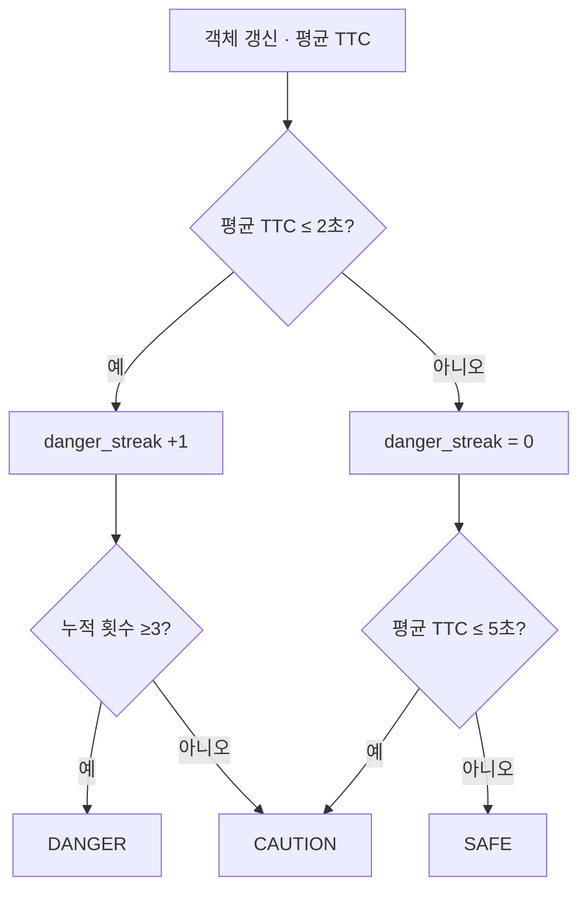

# TTC와 실환경 문제 해결

[README로 이동](../README.md) · [검증](validation.md)

## 문제 → 원인 → 개선 → 검증

| 단계 | 내용 | 근거 수준 |
| --- | --- | --- |
| 문제 | 통제 차량 영상 약 95%에서 보행 환경 50% 이하로 위험 판별 정확도 저하 | 참여자 제공 과거 자체 시험 |
| 원인 분석 | 카메라 흔들림·객체 자세 변화가 Bounding Box의 크기 변화에 영향을 줌 | 참여자 설명. 원시 영상과 사례별 분석 보완 필요 |
| 개선 방법 선정 | 대표 크기 계산 기준과 시간적 판단을 함께 개선 | 참여자 설명 + 현재 코드의 면적 제곱근·평균·연속 조건 |
| 구현 | `sqrt(w*h)`, 유효 TTC 이동평균, 위험 조건 누적, 크기 증가율·하단 이동 필터 | 현재 소스에서 해당 로직 확인 |
| 검증 결과 | 기존 개선 버전 야외 반복 시험에서 약 85% | 과거 자체 시험. 현재 코드와 시험 버전의 정확한 대응은 미확인 |

변경 전 대표 크기의 정확한 수식과 원본 코드가 확보되지 않아 높이·대각선 등 특정 수식으로 단정하지 않습니다. 현재 코드의 모든 필터가 당시 약 85% 결과에 기여했다고 추정하지 않습니다. 개별 개선 효과는 동일 데이터의 요소별 비교 시험이 필요합니다.

## 현재 main의 TTC 계산

근거: [TTCCalculator.update_and_get_fsm](../ttc_calculator.py).

```text
s = sqrt(width × height)
Δs = s_current - s_oldest
Δt = time_current - time_oldest
TTC_raw = s_current / (Δs / Δt)
```

최대 5개 크기 관측 이력에서 가장 오래된 값과 현재를 비교합니다. 시간은 `time.time()` 호출 시각이며 영상 프레임의 원래 촬영 시각이 아닙니다. 시간 차가 0 이하이면 현재 코드는 0.001초로 치환합니다.

| 조건 | 현재 처리 | 해석상의 주의 |
| --- | --- | --- |
| 관측 2개 미만 | inf, SAFE 반환 | 관측 부족이지 안전 증거가 아님 |
| 대표 크기 증가율 >20% | raw TTC=inf | 면적 자체의 20%가 아니라 sqrt(면적)의 증가율. 실제 빠른 접근도 제외 가능 |
| Δs ≤0 또는 하단 좌표 변화 ≤0 | raw TTC=inf | 카메라 움직임·자세에 영향을 받는 휴리스틱 |
| 유효한 팽창 | TTC 산출 후 이력 저장 | 충돌 경로·실거리까지 판정하지 않음 |
| TTC 평균 | 최근 최대 5개 중 inf를 제외한 평균 | 무효 관측이 와도 과거 유효값이 남을 수 있음 |

면적 제곱근 역시 자세 변화나 흔들림에 불변인 값이 아닙니다. 노이즈 완화의 설계 의도와 환경 강건성의 실측 결과를 구분합니다.

## 위험 상태 판정



이는 이전 상태를 별도 저장해 전이하는 enum FSM이 아니라 평균 TTC와 객체별 위험 횟수로 매번 상태를 산출하는 구조입니다. DANGER의 유지·해제도 같은 분기에서 결정됩니다. ROI 이탈·관측 누락 시 계산 함수 자체가 호출되지 않아 3회는 원본 영상의 엄밀한 연속 프레임을 뜻하지 않습니다.

| 이전 출력 | 현재 입력 조건 | 다음 출력 |
| --- | --- | --- |
| 모든 상태 | 평균 TTC ≤2초, 누적 <3 | CAUTION |
| 모든 상태 | 평균 TTC ≤2초, 누적 ≥3 | DANGER |
| 모든 상태 | 2초 < 평균 TTC ≤5초 | CAUTION, 횟수 0 |
| 모든 상태 | 평균 TTC >5초 또는 유효 평균 없음 | SAFE, 횟수 0 |
| 모든 상태 | 객체 누락·ROI 제외 | 함수 미호출. 내부 이력·횟수는 자동 리셋되지 않음 |

## 현재 코드에서 남은 예외와 후속 변경

현재 raw TTC가 inf여도 평균에 이전 낮은 TTC가 남으면 위험 횟수가 증가할 수 있습니다. 후속 자료는 무효 관측 시 평균·횟수 초기화, 현재 raw와 평균의 동시 조건, 관측 누락·만료 처리로 이를 다룹니다. 이 변경은 **현재 main에 없으며**, 최신 장치 성능을 측정한 근거도 아닙니다. [버전별 차이](versions.md)
