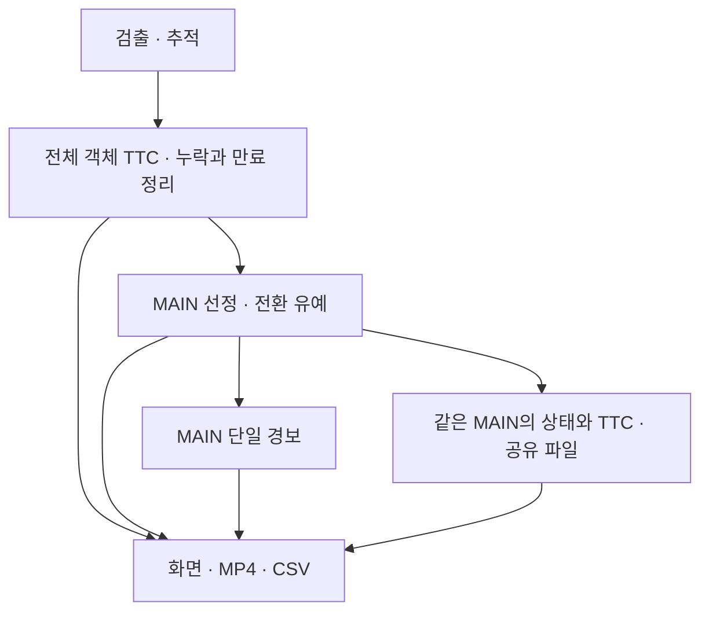

# 버전별 구현과 검증 범위

[README로 이동](../README.md)

아래 구분은 문서의 비교 범주이며 Git 태그나 정식 릴리스 이름이 아닙니다. 시험 당시 소스와 현재 main을 동일 버전으로 간주하지 않습니다.

| 구분 | 식별 근거 | 구현·결과 | 검증 한계 |
| --- | --- | --- | --- |
| 과거 초기 방식 | 참여자 설명, 정확한 커밋 미확인 | 통제 영상 약 95%, 실제 보행 50% 이하 | 원본 코드·표본·정답·로그 필요 |
| 과거 실환경 개선 | 참여자 설명, 정확한 커밋 미확인 | 대표 크기·시간적 판단 개선 후 약 85% | 현재 main의 수치로 전용하지 않음 |
| 현재 GitHub main | `700442e98df8d272e1125d509d7a5ed0b8055098` | 면적 제곱근 TTC, 유효값 평균, 위험 3회, 객체별 콘솔 경고 | 정적 분석·합성 입력 회귀 사례 확인, 장치 실행 미검증 |
| 후속 통합 자료 | `ttc_camera_ble_csv_video_20261006.zip` | 주요 대상 선정, 이력 정리, 단일 경보, CSV·영상, BLE용 파일 | 저장소 미반영. 장치·실환경 성능 미검증 |

후속 ZIP은 별도로 제공된 비교 자료입니다. 공개 다운로드 링크가 현재 저장소에 없으며, 실행 파일을 이 문서 변경에 함께 포함하지 않습니다. 검토한 ZIP의 SHA-256: `ff9847ad411a26d6dad3b193a4c3807015464bd3fc0d7e5c4b2e79b6be28255f`.

## 현재 main과 후속 자료 비교

| 항목 | 현재 main | 후속 2026-10-06 자료 |
| --- | --- | --- |
| 대표 크기 | `sqrt(w*h)` | `sqrt(w)*sqrt(h)`; 같은 대표 크기 정의 |
| 시간 | `time.time()` | monotonic 또는 명시적 영상 시간 |
| 현재 접근 근거 상실 | 과거 유효 평균이 남을 수 있음 | 평균·위험 횟수 초기화, 최근 크기 증가 확인 |
| 위험 판정 | 평균 TTC와 횟수 | 현재 raw 및 평균 TTC 모두 조건 충족 필요 |
| 누락·조건 이탈 | 자동 이력 정리 없음 | 누락 시 근거 초기화, ROI/높이 이탈 시 삭제, 기본 0.5초 초과 만료 |
| 주요 위험 대상 | 별도 선정 없음 | 위험 등급 우선, 같은 등급은 짧은 TTC; 전환 유예 |
| 경보 | 객체별 출력·간격 | MAIN 한 대상 기준 단일 경보 |
| 기록 | 화면·콘솔 | MP4·프레임/객체/이벤트 CSV·메타데이터 |
| BLE | 없음 | MAIN 상태와 TTC를 공유 파일에 기록. 무선 송신기는 별도 |
| 카메라 기본 요청 | 1536×864/60fps | 화면 크기/30fps, max-buffers=1, 준비 대기 |

후속 자료의 같은 등급 대상 전환 기준은 TTC 20% 이상 우세한 상태를 0.3초 유지하는 것입니다. 더 높은 위험 등급 또는 기존 MAIN 소실은 즉시 재선정합니다. 후보가 없을 때 BLE 출력만 최대 1초 유지하며, MAIN을 계속 추적하는 기능과 다릅니다. 임계값은 실측 전 시작값입니다.

## 후속 데이터 흐름 — 저장소 미반영

후속 자료의 `annotations_template.csv`는 빈 정답 양식입니다. 영상·CSV를 저장한다는 사실만으로 정확도를 계산할 수 없습니다. 저장 영상은 고정 FPS이므로 실제 경과시간 분석에는 CSV의 시간 필드를 사용해야 합니다. `ble_write_ok`도 무선 수신 성공을 뜻하지 않습니다.

후속 기능을 반영하려면 별도 기능 PR에서 설정 호환성·HEF 파서·장치 구동·로그 정합성을 검증해야 합니다. 이번 문서 개선 범위에는 기능 적용이 포함되지 않습니다.
